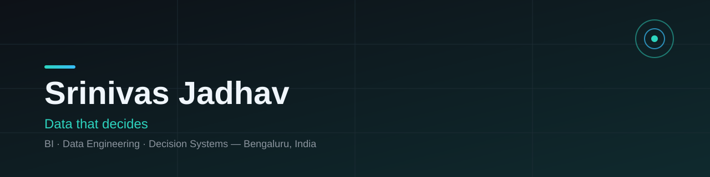

# Hi, I'm Srinivas Jadhav

B.E. Data Science student in Bengaluru. My lane is data that decides: BI, data engineering and decision systems. I build things that show where money leaks, what to do about it, and whether the decision was right.

## What I build

| Project | What it does | Stack |
| --- | --- | --- |
| [FactoryPulse](https://github.com/Sonu-mj/factorypulse-machine-intelligence) | Machine failure-risk prediction on 10,000 records. 96.97% ROC-AUC, 70.59% recall at a 0.45 threshold. | Python, scikit-learn, FastAPI, Streamlit |
| [RetailIQ](https://github.com/Sonu-mj/retailiq) | Multi-outlet retail POS with anomaly detection and 168-hour demand forecasts. Live. | Python, Supabase, Next.js |
| [DairyChain](https://github.com/Sonu-mj/dairychain) | Dairy supply chain analytics on 99,584 records. Found Rs 5.99 crore of rejected milk out of Rs 48.19 crore purchased. | Python, PostgreSQL, Power BI |
| [AirBrush](https://github.com/Sonu-mj/airbrush) | Browser art studio with 10 styles, voice input and a saved gallery. | JavaScript, Web Speech API, IndexedDB |

FactoryPulse and DairyChain use synthetic data, stated in each repo. RetailIQ is live at https://retailiq-jade.vercel.app

## Tech stack

## GitHub stats

## Now

- Building the RetailIQ Decision Layer: forecast confidence intervals, rupee ranges, and a decision log.
- Open to Data Science, ML and Data Engineering internships in Bengaluru or remote.

## Find me

- Portfolio: https://sonu-mj.github.io/portfolio/
- LinkedIn: https://www.linkedin.com/in/jadhav-srinivas
